  
  
  
  
  
  

### `$ cat ./whoami.md`

I design, run and analyse **surveys, impact evaluations and randomized controlled trials** for universities, UN agencies, governments and NGOs, and I build the **data systems and software** that keep those programmes running. The job usually starts before the first interview: sampling, instruments, SurveyCTO/ODK programming with quality checks built in, enumerator training. Then back-checks, audio audits and daily reporting from the field, and finally cleaning, analysis, dashboards and the report.

Outside research I build websites, MIS and management software. **82 of those platforms are live today.**

### `$ ls ./stack`

  <b>Statistics &amp; analysis</b> 
  
  
  
  
  
  
  
  

  <b>Data collection</b> 
  
  
  
  
  
  

  <b>Dashboards &amp; GIS</b> 
  
  
  
  
  
  

  <b>Web, MIS &amp; software</b> 
  
  
  
  
  
  
  
  
  

  <b>Workflow &amp; design</b> 
  
  
  
  
  

  <b>Methods</b> 
  <code>RCTs &amp; impact evaluation</code> <code>baseline / midline / endline</code> <code>tracer studies</code> <code>audit studies</code> <code>CATI phone surveys</code> <code>FGD · KII · IDI</code> <code>high-frequency checks</code> <code>back-checks &amp; audio audits</code> <code>OECD-DAC</code>

### `$ git log --oneline ./research`

| Study | Partner | When | Method |
|---|---|---|---|
| [**Demand for Clean Air in the Workplace**](https://iamzahirul.com/research/clean-air-in-the-workplace/) | UC San Diego | 2025–26 | RCT · PM2.5 sensors · SurveyCTO |
| [**Impact Assessment of CDSP IV**](https://iamzahirul.com/research/cdsp-iv-impact-assessment/) | IFPRI · IFAD | 2024–25 | Impact evaluation · Survey Solutions · Stata |
| [**Skill for Growth**](https://iamzahirul.com/research/skill-for-growth/) | University of Minnesota | 2024–25 | Firm survey · HFCs |
| [**Household Air Filter Project**](https://iamzahirul.com/research/household-air-filter/) | UC San Diego | 2022–25 | RCT · 40 → 1,000 → 2,500 households |
| **Brick Kiln Tracker, 43 districts** | National University of Singapore | 2023–now | Tracker · dashboard · GIS |
| **TKSS Formative Assessment RCT** | World Bank | 2022–23 | 468 schools · 21,757 students |
| **REACH TO TEACH** | World Bank | 2021–23 | 27,000 teachers screened by phone |
| **Dhaka Strategic Transport Plan survey** | ADB · DTCA | 2013 | 51,000 households |

All 107 assignments and 9 case studies → <a href="https://iamzahirul.com/research/">iamzahirul.com/research</a>

### `$ ls ./systems --live`

82 live web and software platforms: clinic and hospital portals, school result systems, ERPs, marketplaces, a Bangla news portal. A few with public demos:

| System | What it does |
|---|---|
| [**ZI Survey Dashboard**](https://zi-survey-demo.vercel.app) | KoBo / SurveyCTO data → indicators, cross-tabs and enumerator quality flags |
| [**ZI School**](https://zi-school-demo.vercel.app) | Results, admit cards and fees for schools |
| [**ZI POS**](https://zi-pos-demo.vercel.app) | Point-of-sale, billing and stock for shops |
| [**ZI Doctor Chamber**](https://zi-chamber-demo.vercel.app) | Patient serial and digital prescriptions |
| [**ZI Certify**](https://zi-certify-demo.vercel.app) | Training certificates with QR verification |
| [**ZI Somiti**](https://zi-somiti-demo.vercel.app) | Savings and microcredit management |

Full archive → <a href="https://iamzahirul.com/projects/">iamzahirul.com/projects</a>

### `$ ls ./open-source`

| Repo | What it does |
|---|---|
| [**Odk2Word**](https://github.com/iamzahirul/Odk2Word) | ODK / KoBo / SurveyCTO XLSForms → formatted, multilingual Word questionnaires |
| [**maps_places_scraper**](https://github.com/iamzahirul/maps_places_scraper) | Public business data from Google Maps search results |
| [**Excel_Sheet_Merge**](https://github.com/iamzahirul/Excel_Sheet_Merge) | Merge and standardize messy multi-sheet workbooks |
| [**stata_repo_package**](https://github.com/iamzahirul/stata_repo_package) | Reproducible Stata project template |
| [**bijoy-unicode-converter-v2**](https://github.com/iamzahirul/bijoy-unicode-converter-v2) | Bijoy ⇄ Unicode Bangla converter, engine written from scratch |
| [**codebhasha**](https://github.com/iamzahirul/codebhasha) | Programming errors explained in plain Bangla |
| [**git-game-bangla**](https://github.com/iamzahirul/git-game-bangla) | Learn Git in 10 levels, fully in Bangla |
| [**taka-in-words**](https://github.com/iamzahirul/taka-in-words) | Cheque-ready Taka amounts in Bangla, Banglish and English |

### `$ cat ./publications.bib`

- **Determinant on Economic Growth in Developing Country: Turkey and Bangladesh** · *Journal of the Knowledge Economy* (Springer), 2024 · [DOI](https://doi.org/10.1007/s13132-024-01989-8)
- **Residents' mental health in Dhaka neighbourhoods: civic health and environmental well-being** · *Research Square* preprint, 2024 · [DOI](https://doi.org/10.21203/rs.3.rs-4333520/v1)
- **Building Sustainable Futures: Disaster Resilience and Economic Empowerment in Cox's Bazar** · ARCED Foundation with GUK, 2024
- **COVID-19 lockdowns and tobacco use among private university students in Dhaka** · *Global Journal for Research Analysis*, 2022

### `$ git log --graph`

<picture>
  <source media="(prefers-color-scheme: dark)" srcset="https://raw.githubusercontent.com/iamzahirul/iamzahirul/output/github-snake-dark.svg">
  <source media="(prefers-color-scheme: light)" srcset="https://raw.githubusercontent.com/iamzahirul/iamzahirul/output/github-snake.svg">
  
</picture>

  

